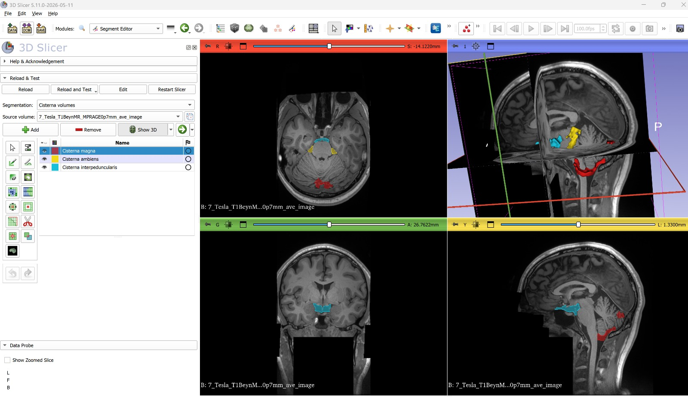

# SlicerCisternaVolumetry (3D Slicer extension)

A scripted module that computes the volumes of five basal cisterns (magna,
interpeduncularis, cruralis, ambiens, quadrigeminalis) from a T1 scan and one of
two segmentations:

- **VolBrain / vol2Brain** output: `native_tissues` + `native_structures`, or
- **SynthSeg 2.0 with cortical parcellation**: made with the
  [SlicerSynthSeg](https://github.com/niyaziacer/SlicerSynthSeg) module, with
  FreeSurfer (`mri_synthseg --i T1.nii.gz --o seg.nii.gz --parc`), or on turkbrain.net.
  With SynthSeg the table also lists the lateral, 3rd and 4th ventricles, the total
  extra-ventricular CSF and the intracranial volume.

The result is added to the scene as a colored/labeled segmentation and listed in a
volume table.

The analysis logic (ROI boxes, axis-orientation normalization, mm-based
scaling, connected-component selection) lives in
`CisternaMagnaVolumetry/CisternaMagnaVolumetryLib/cisterna_core.py` - this is the **same code path** as
the CLI tool (see [`cisterna-magna-volumetry`](https://github.com/niyaziacer/cisterna-magna-volumetry)),
just a separate copy.

## Method (v2, October 2026)

The first version cut the cisterns out of the CSF mask with fixed boxes placed
around the 4th ventricle and the brainstem. On real data the interpeduncular box
also took in the suprasellar and prepontine cisterns (6.2 cm³ instead of about
0.8 cm³ in the manual mask), and the ambiens box reached down to the pons. Version 2
defines the cisterns relative to the midbrain and cerebellum surfaces:

- **Midbrain level.** The pontomesencephalic junction is found from the brainstem
  label itself: it is the highest slice where the anterior edge of the brainstem
  jumps forward (the pons).
- **Cisterna interpeduncularis.** Midline CSF (±8 mm) in front of the midbrain
  floor, from the junction up to the top of the brainstem, and not more than 8 mm
  in front of the upper pons, and not more than 3 mm in front of the anterior tips of
  the two cerebral peduncles. This leaves out the prepontine cistern (below) and
  the suprasellar cistern (in front).
- **Cisterna cruralis** and **cisterna ambiens** (reported separately). Both are
  the CSF between the midbrain and the mesial temporal lobe (amygdala, hippocampus,
  entorhinal area, parahippocampal gyrus): within 8 mm of the midbrain surface and
  not on the temporal side of the gap. Following Rhoton's division of the posterior
  cerebral artery, the anterior 40% of the midbrain's antero-posterior extent (the
  cerebral peduncle, P2A segment) is the crural cistern and the rest, up to the
  lateral end of the quadrigeminal plate (P2P segment), is the ambient cistern. The
  quadrigeminal cistern behind the tectum is not included. The ambient cistern also
  extends 6 mm below the pontomesencephalic junction beside the upper pons (its
  infratentorial part, which contains the superior cerebellar artery).
- **Cisterna quadrigeminalis** (cistern of the great cerebral vein). Midline CSF
  behind the tectum: beside the midbrain within 12 mm of the midline and up to
  15 mm behind its posterior surface (the superior cerebellar cistern further back is
  not included); above the brainstem (pineal region, vein of Galen) within 7 mm of
  the midline, up to 12 mm higher and 30 mm back, under the splenium. Laterally it
  is continuous with the ambient cistern; the boundary is the lateral end of the
  quadrigeminal plate.
- **Cisterna magna.** CSF below the cerebellum (only in columns that have cerebellum above them, so
  the retrocerebellar CSF behind the hemispheres is excluded; in each column not above the
  lowest cerebellar voxel), behind the medulla, within 15 mm of the midline and not
  higher than 8 mm above the lower end of the 4th ventricle. The lower surface of the cerebellum is
  smoothed first (5 mm grey opening of its height map), so CSF in the fissures between the folia is
  not counted. The 15 mm lateral limit is an operational limit (about half the transverse diameter
  of the foramen magnum); no membrane separates the cistern laterally. The lateral
  cerebellomedullary cisterns, which some authors count as the lateral part of the
  cisterna magna, are not included. The lower limit is the lower edge of the
  segmentation. In SynthSeg this edge lies at the level of the foramen magnum (from the
  lower end of the occipital squama to the tip of the clivus; checked by eye on the
  midsagittal slice of 20 scans from one scanner, to within a few millimetres), so the
  spinal CSF behind the cord is not counted. Check this on data from other scanners.
  With tonsillar herniation (Chiari I) the cistern is effaced and the cisterna magna
  volume is small; this is the expected result, not an error.

Landmarks use the vol2Brain (Neuromorphometrics) labels: brainstem 35, 4th
ventricle 11, ventral DC 61/62, cerebellum 38–41, vermis 71–73, amygdala 31/32,
hippocampus 47/48, entorhinal area 116/117, parahippocampal gyrus 170/171. With SynthSeg the
same landmarks come from the FreeSurfer labels (brainstem 16, 4th ventricle 15, ventral DC
28/60, cerebellum 7/8/46/47, hippocampus 17/53, amygdala 18/54, entorhinal 1006/2006,
parahippocampal 1016/2016; CSF 24). SynthSeg often labels the thin CSF in the
interpeduncular fossa as ventral DC or brainstem; in a 3 mm shell around these labels,
voxels darker on T1 than the midpoint between CSF and tissue are moved back to CSF. The
old method is kept in the code as `make_cistern_masks_v1()`.

### Validation against manual masks

| Case | Cistern | Manual | v1 (boxes) | v2 |
|---|---|---|---|---|
| Case 1 (1 mm) | interpeduncularis | 0.80 cm³ | 6.18 cm³, Dice 0.17 | 0.80 cm³, Dice 0.56 |
| Case 2 (7T, 0.7 mm) | magna | 5.30 cm³ | 8.05 cm³, Dice 0.43 | 3.58 cm³, Dice 0.60 |
| Case 1 (1 mm) | ambiens (lateral part of the manual mask) | 2.81 cm³ | — | 3.32 cm³, Dice 0.66 |
| Case 1 (1 mm) | quadrigeminalis (midline part of the manual mask) | 4.37 cm³ | — | 5.71 cm³, Dice 0.66 |

In case 2, 37% of the manual cisterna magna lies outside VolBrain's brain mask
(cropped at the foramen magnum) and only 55% of it is labelled CSF by VolBrain, so
no method working on the VolBrain CSF mask can reach the rest; v2 recovers 91% of
the reachable part. The ambiens and quadrigeminalis limits were set on the same case they are
scored on, so these two Dice values are optimistic (so is the interpeduncular value: the
peduncle limit was added after looking at this case). The SynthSeg route has no
manual-mask comparison yet; on 20 T1 scans (10 controls, 10 Parkinson's disease) the
interpeduncular cistern ranged 0.13–1.25 cm³ and every mask was checked visually. Two cases are not a validation
study: treat the volumes as research measurements and check every result
visually.

## Installation (no build required)

Scripted modules can be loaded in 3D Slicer without compiling anything:

1. Go to this extension's GitHub page and download it as a ZIP
   (`Code` → `Download ZIP`).
2. Extract the ZIP anywhere on your computer.
3. Open 3D Slicer.
4. Go to `Edit` → `Application Settings` → `Modules` tab.
5. Under `Additional module paths`, click `Add`, and select the
   `CisternaMagnaVolumetry/CisternaMagnaVolumetry` folder inside the folder
   you just extracted (i.e. the inner folder that directly contains
   `CisternaMagnaVolumetry.py`, not the outer/repo folder).
6. Click `OK`, then **close and reopen 3D Slicer** for the new module path to
   take effect.
7. After restarting, the module appears under the `Segmentation` category as
   "Cisterna Magna Volumetry" (also searchable by name in the modules
   dropdown/search box).

## Usage

**Step 1 - Get a segmentation.** Either VolBrain (below) or SynthSeg: run the
SlicerSynthSeg module with the model *SynthSeg 2.0 + cortical parcellation* (or load a
`*_synthseg.nii.gz` made with `mri_synthseg --parc` / turkbrain.net), then in Step 3 choose
*Segmentation source: SynthSeg 2.0 + cortical parcellation* and select the T1 and the
SynthSeg result (label volume or segmentation). SynthSeg 1.0 has no extra-ventricular CSF
label and cannot be used.

For VolBrain: Upload the subject's T1-weighted
volumetric MRI to [VolBrain](https://volbrain.net/) and run the segmentation
pipeline. From the finished VolBrain job, download at least these three
files:

- `native_t1_*.nii.gz` (or use your original T1 file directly)
- `native_tissues_*.nii.gz`
- `native_structures_*.nii.gz`

**Step 2 - Load the files into Slicer.** In 3D Slicer, use `Add Data` (or
drag and drop) to load all three files: the T1 volume, `native_tissues`, and
`native_structures`.

**Step 3 - Run the module.**

1. Switch to the "Cisterna Magna Volumetry" module (Segmentation category, or
   search for it by name).
2. In the module panel, pick the matching volume for each of the three
   dropdowns: `T1 volume`, `native_tissues`, `native_structures`.
3. Click **Calculate**.
4. If `nibabel`/`scipy` aren't installed yet in Slicer's Python environment, a
   confirmation dialog appears the first time - accept it (this installs the
   two packages into Slicer; restart Slicer once if prompted, then click
   Calculate again).
5. Result: a segmentation named "Cisterna volumes" is added to the scene (red
   = magna, yellow = ambiens, cyan = interpeduncularis, green = cruralis, purple =
   quadrigeminalis), outlines appear
   automatically in the 2D slice views and the 3D view, and the module panel
   table lists voxel/mm³/cm³ volumes for each cistern.

## Known limitations (summary)

- VolBrain's atlas has no cistern-level labels - the method is a
  landmark-based heuristic, not an atlas shortcut.
- SynthSeg's CSF reaches further around the cerebellum, so its cisterna magna is larger
  (it includes retrocerebellar CSF). Do not mix VolBrain and SynthSeg values in one study.
- Most missed voxels (51-79% depending on the case) come from VolBrain's
  brain-extraction mask cropping the image at the foramen magnum - a ceiling
  independent of this extension.
- The script's mask tends to slightly over-include adjacent cerebellar sulcal
  CSF compared to a manual mask.

Full validation reports: [`docs/validation/`](https://github.com/niyaziacer/cisterna-magna-volumetry/tree/main/docs/validation) in the CLI repo.

## Packaging as an extension / submitting to the Extensions Index

The `CMakeLists.txt` files in this folder follow the standard Slicer extension
build template and are kept consistent with this README (name, description,
icon/screenshot URLs, license). See the repo's PR to
[Slicer/ExtensionsIndex](https://github.com/Slicer/ExtensionsIndex) for the
submission itself.

It works fully without a build step too (via "Installation" above) -
submitting to the Extensions Index is only needed for distribution through
the built-in Extension Manager.

## Testing notes

This module was developed in an environment without a real 3D Slicer instance
(Slicer isn't installed there), so Python syntax was checked with
`py_compile`, and the `slicer.util.arrayFromVolume`/`GetIJKToRASMatrix`
axis-conversion math was independently simulated with nibabel. It has since
been live-tested inside 3D Slicer 5.11.0 by the repo owner on both validation
cases:

- Case 1 (1mm): magna/ambiens/interpeduncularis segmented and voxel counts
  matched the CLI tool exactly.
- Case 2 (7T, 0.7mm): 23505 voxels / 8.050 cm³ for cisterna magna, 5424 / 1.858
  cm³ for ambiens, 14887 / 5.098 cm³ for interpeduncularis - identical to the
  CLI output on the same data.

Both runs confirm the Slicer extension and the CLI tool (`cisterna_core.py`)
stayed in sync. These numbers were produced with method v1; the CLI repo has not
been updated to v2 yet.

## License

[MIT](LICENSE)

## Developer

Prof. Dr. Niyazi Acer (Retired, Erciyes University)
